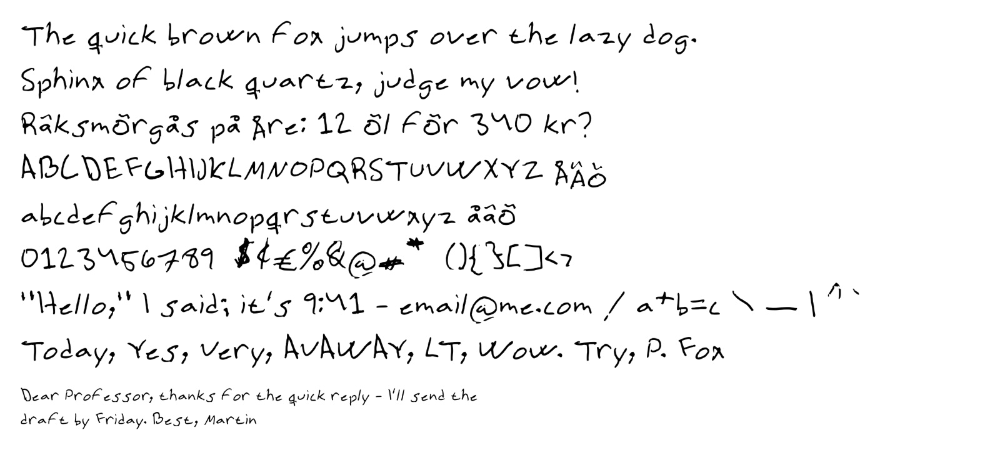
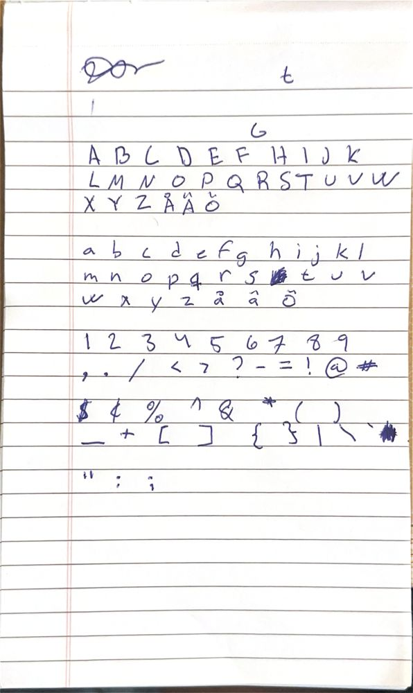
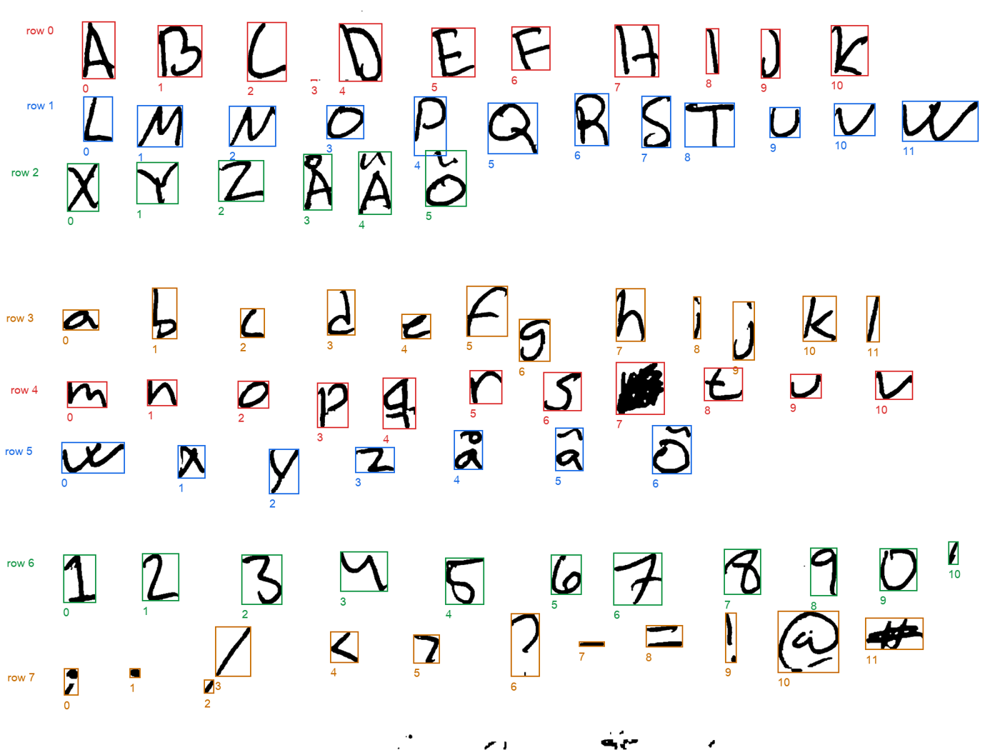
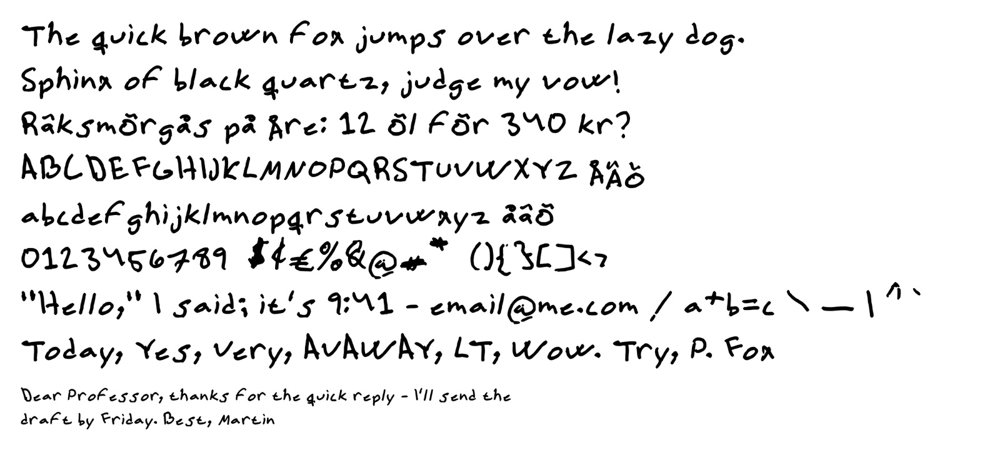
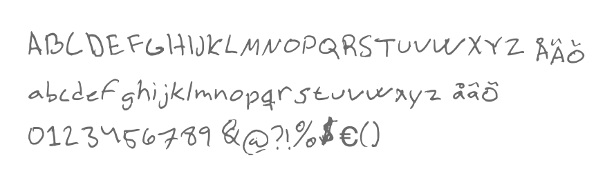

# Freehandfont

Turn your handwriting into a real font you can install and type with. All you need is a pen, some paper and your phone.



It's a [Claude Code](https://claude.com/claude-code) skill. Type `/freehandfont` and Claude walks you through it: write the alphabet, send photos, get `.otf` files back.

## How it works

**1. Write.** Capitals, small letters, digits and punctuation, in rows, on any paper. Ruled is fine. Leave a little space between characters. Then take a photo or two. Crossed-out bits are fine.



**2. Cut.** The script finds the ink (it ignores the ruled lines), groups it into rows and boxes every character. Claude looks at the boxes and says which letter is which. Scribbles and specks get skipped.



**3. Check.** It lists what's missing or looks off. You rewrite just those on any scrap of paper and send one more photo.

**4. Build.** Every letter is traced into curves and sized from your own capitals and small letters, so photos taken from different distances still match. You get an `.otf` with spacing and kerning. Write a second set with a thicker pen and you get Bold too.



**5. Proof.** A sheet with every glyph and tricky pairs like "AV" and "To", so you can see spacing problems before you install.

**6. Use it.** Install steps for Mac and Windows, and a `@font-face` snippet for the web.



## Install the skill

```bash
git clone https://github.com/MamamaMartin/freehandfont ~/.claude/skills/freehandfont
```

Then type `/freehandfont` in Claude Code.

## Use it without Claude

```bash
pip install -r requirements.txt
python freehandfont.py cut photo.jpg --pen blue --out work/regular
# open work/regular/preview-photo.png and write rows.txt: one line per row, the characters in order
python freehandfont.py cut photo.jpg --pen blue --rows rows.txt --out work/regular
python freehandfont.py build work/regular --name "My Hand" --out out
python freehandfont.py proof out/MyHand-Regular.otf out/proof.pdf
```

Prefer to print? `python freehandfont.py template --out work` makes a sheet with a box for each character, and `extract` reads it without a rows file. `python test_roundtrip.py` checks both routes on fake photos.

## Why

I made a font of my own handwriting for [my site](https://martinkullander.com) and wanted anyone to be able to do the same.

MIT licensed.
